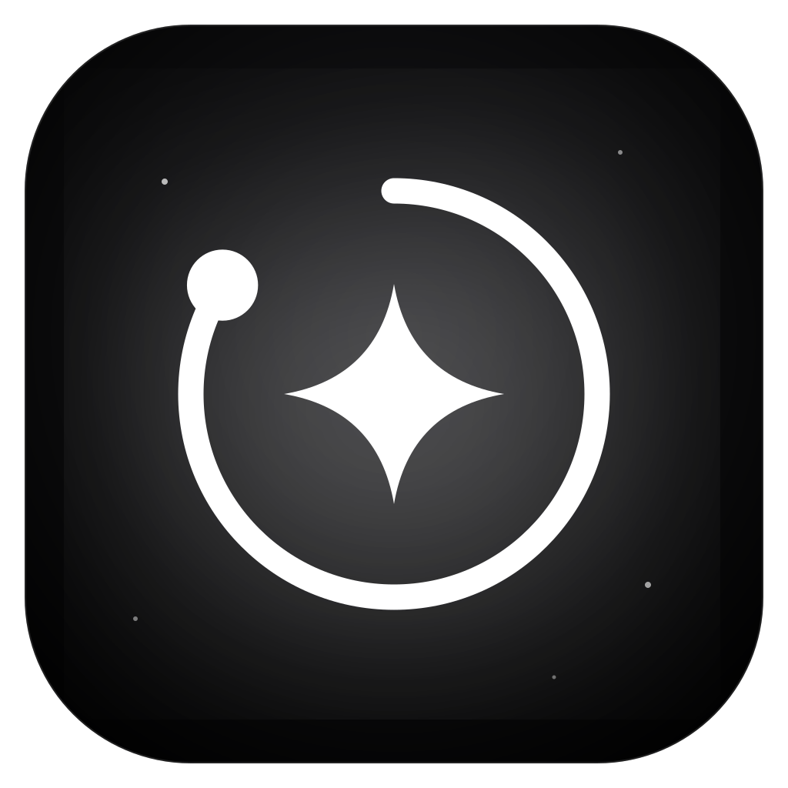

<p align="center">
  
</p>

<h1 align="center">Beyond Human</h1>

<p align="center">The goal app that turns your year into a galaxy. Light up all 365 days.</p>

<p align="center">
  
</p>

Beyond Human is a Windows app for goals, habits, focus and daily planning. Every day you show up becomes a star in a real-time 3D orbit of your year, rendered on the GPU with WebGPU.

## Download

Get the latest `Beyond-Human-Setup-x.y.z.exe` from [Releases](../../releases). It installs per-user, so no admin rights are needed, and adds Start Menu and desktop shortcuts.

The installer isn't code-signed yet, so the first time Windows SmartScreen shows "Windows protected your PC". Click **More info**, then **Run anyway**.

## Features

| | |
| --- | --- |
| **Today** | Your year as a 3D orbit beside a grid of all 365 days, linked both ways on hover. Today's plan, habits, a daily quote, streak, XP and your North Star goal. |
| **Planner** | Day timeline with time blocks, a week strip, quick add, and moving unfinished tasks to the next day. |
| **365** | Every day of the year as a star. Light days up, log mood and notes, in a months grid or the 3D orbit. |
| **Goals** | A North Star, goals with deadlines, milestones, manual progress and linked tasks. |
| **Habits** | Weekly check grid, streaks, 30-day consistency, a 22-week heatmap, reminders and archive. |
| **Focus** | Pomodoro timer with breaks and cycles, deep or rain background sound, and zen mode. |
| **Journal** | Mood, three gratitudes, a win, a lesson, tomorrow's intention, free writing and a daily prompt. |
| **Vision board** | Drag-and-drop images and affirmations, with a full-screen slideshow. |
| **Insights** | Daily brightness, focus minutes, strongest weekdays, mood and habit consistency. |
| **Achievements** | 12 ranks from Spark to Beyond Human, 26 badges, and a full-screen level-up moment. |
| **Share your year** | A card of your orbit and stats sized for Instagram posts and stories, saved or copied in one click. |
| **Notifications** | Morning briefing, habit reminders, upcoming tasks, afternoon quote, streak guard, evening reflection, focus timer, goal deadlines and level-ups, all delivered from the tray. |

Shortcuts: `Ctrl+K` command palette (anything that isn't a command becomes a task), `Ctrl+N` new task, `Ctrl+1` to `Ctrl+9` jump between screens, `Space` starts or pauses the focus timer.

<p align="center">
  
  
  
  
</p>

## Graphics

All drawing happens on one full-window canvas using three.js r186 on WebGPU, falling back to WebGL 2 and then to a 2D canvas.

- **Universe:** thousands of GPU-placed stars with a Milky Way band, twinkle and diffraction flares, over a fractal-noise nebula baked to a texture at startup.
- **Year orbit:** 365 day stars on a tilted ring inside a dust disk of up to 22,000 grains, with a cinematic camera intro.
- **Ignition:** lighting a day fires a shockwave, a bloom flash and thousands of sparks simulated in a WebGPU compute shader.
- **Frame rate:** dynamic resolution scaling holds it steady. Quality tiers (Ultra, High, Battery saver) set pixel density, particle counts and bloom.
- **Self-healing:** if the graphics driver crashes or WebGPU loses its device, the app switches itself to a safe renderer and explains why in Settings.

Motion uses GSAP (SplitText headline reveals, count-ups) and framer-motion.

## Your data

Everything stays on your PC in `%APPDATA%\Beyond Human\beyond-human.json`, with a rolling backup beside it. Settings can export and import backups. A diagnostic log lives in `logs\main.log`, and crash dumps (never uploaded) under `Crashpad`.

## Development

Requires Node.js 20 or later on Windows.

```bash
npm install
npm run dev
```

| Script | What it does |
| --- | --- |
| `npm run dev` | Vite and Electron with hot reload |
| `npm run start` | Production build running in Electron |
| `npm run dist` | Icons, build and the Windows installer in `release/` |
| `npm run icons` | Regenerates every icon from the logo in `scripts/make-icons.mjs` |
| `npm run marketing` | Renders the still ads in `marketing/` from their HTML templates |

### Releasing

Push a version tag and GitHub Actions builds the installer and attaches it to a new release:

```bash
git tag v1.2.0
git push origin v1.2.0
```

Every push to `main` also runs a build check.

### Project layout

```
electron/            main process: window, tray, IPC, storage, notifications, logging
shared/quotes.json   quotes used by the app and the notifications
src/gfx/             WebGPU engine: universe, 3D year orbit, shaders
src/state/           store, actions, achievement and level watcher
src/lib/             dates, XP and streaks, sound, focus timer, share card, platform bridge
src/components/      orbit, grids, modals, charts, title bar, sidebar
src/views/           one file per screen
marketing/           ads, promo videos, screenshots and their templates
build/               icons and installer customisation
```

## Marketing kit

[`marketing/`](marketing/README.md) holds a 29-second promo in vertical (Reels, TikTok, Shorts) and landscape (YouTube) cuts, Instagram post and story ads, a YouTube thumbnail and channel banner, screenshots, and ready-to-post captions and hashtags.

## License

Copyright © 2026 Beyond Human. All rights reserved. See [LICENSE](LICENSE).
